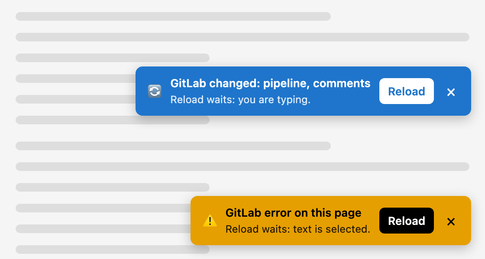

# gitlab-live-refresh

The reload button for GitLab, pressed for you. Merge request, pipeline and job
pages reload themselves when something changes, never while you type. A browser
extension for Chrome and Firefox, and a userscript.

[](#install-the-extension)
[](#install-the-extension)
[](#or-the-userscript)
[](#)
[](CONTRIBUTING.md#check-a-change)
[](https://github.com/TomyCesaille/gitlab-live-refresh/blob/main/LICENSE)
[](https://github.com/TomyCesaille/gitlab-live-refresh/actions/workflows/ci.yml)



[Website](https://tomycesaille.github.io/gitlab-live-refresh/) | [Latest release](https://github.com/TomyCesaille/gitlab-live-refresh/releases/latest)

## Why

GitLab's pages are meant to update themselves. Often they do not: a pipeline
still reads `running` long after it passed, a merge request misses the comment
that just landed, and you reload to find out. gitlab-live-refresh asks GitLab
what changed and reloads the page for you, at a moment that costs you nothing.

- **It reloads for what you would reload for:** a pipeline or job status,
  commits, a comment, approvals, the merge status, the state of the merge
  request.
- **Never while you type,** while a draft is on screen, while text is selected or
  while a menu or dialog is open. It waits until you have been idle for 8
  seconds, and a banner says what changed and what the reload waits for.
- **Edits wait for the page to settle.** A bot rewriting its comment three times
  in a row costs one reload, 30 seconds after the last edit.
- **Bursts cost one or two reloads.** Automatic reloads are 45 seconds apart, 3
  minutes in a background tab: a push, its pipeline and the bots' comments do
  not reload the page five times.
- **Coming back to a tab reloads it at once** when something changed, before you
  start reading.
- **You land where you were.** GitLab scrolls inside a panel that the browser
  does not restore on reload; gitlab-live-refresh restores it.
- **"Something went wrong" reloads too,** at most 3 times per page until you
  reload it yourself.

## Install the extension

Download the Chrome or Firefox build from the
[latest release](https://github.com/TomyCesaille/gitlab-live-refresh/releases/latest).
In Chrome, unzip it, open `chrome://extensions`, turn on Developer mode and
choose Load unpacked. The Chrome Web Store and Firefox Add-ons listings are on
the way.

Then open a GitLab page, click the extension's icon and turn live refresh on for
that site. It asks for that one site's permission, nothing more, and works the
same on gitlab.com and on a self-hosted instance.

## Or the userscript

With [Violentmonkey](https://violentmonkey.github.io/) or Tampermonkey installed,
open
[gitlab-live-refresh.user.js](https://github.com/TomyCesaille/gitlab-live-refresh/releases/latest/download/gitlab-live-refresh.user.js).
It runs on the merge request, pipeline and job pages of any GitLab host, with no
setup, and updates itself from the latest release.

## Extension or userscript

Both make the same decisions; the extension also keeps background tabs current.

| | Extension | Userscript |
|---|---|---|
| Background tabs | Read every minute by the extension's background worker, and reloaded there when something changed | Caught up the moment you come back: Chrome freezes background tabs, and nothing inside a frozen page runs |
| Several tabs on one page | One read from GitLab, shared | One read per tab |
| Where it runs | The sites you turn on, one permission each | Merge request, pipeline and job pages on any host |
| "Something went wrong" | Any page of those sites | Merge request, pipeline and job pages |
| Needs | Nothing else | Violentmonkey or Tampermonkey |

## How it works

Each page has a fingerprint: the few values that would make you reload it.
gitlab-live-refresh reads it from GitLab's API, as you, with your session, and
compares it with the fingerprint the page loaded with.

| Page | Fingerprint |
|---|---|
| Merge request | state, head commit, comment count, head pipeline and its status, merge status, approvals, last update |
| Pipeline | status, every job and downstream pipeline with its status |
| Pipeline list | the 20 pipelines it shows, with each stage's status, under the page's filters |
| Job | status |

```
 visible tab                        extension background               GitLab API
 ───────────                        ────────────────────               ──────────
 page loads ─── hello ────────────▶ baseline fingerprint ────────────▶ GET, as you
 every 15 s ─── check ────────────▶ fingerprint now ─────────────────▶
            ◀── what changed
 idle, no draft, no menu?
   yes ─▶ reload, back where you were
   no  ─▶ banner: "Reload waits: you are typing."

 background tab, frozen or not      every minute: read it ───────────▶
                                    changed ─▶ reload the tab
```

The userscript runs the same decisions inside the page, background tabs
included, until Chrome freezes them.

Every request is a read: GraphQL goes over GET, which needs no CSRF token.
Nothing leaves your browser except those reads to your own GitLab.

## See what it does

On any GitLab page of the site, in the browser console:

```js
localStorage.setItem('gl-live-refresh:debug', '1')
// later, every tab of the site in one list, across reloads:
JSON.parse(localStorage.getItem('gl-live-refresh:trace')).join('\n')
```

Each line carries the time, the tab, whether it was visible (`v`) or not (`h`),
and what happened: `poll: pending pipeline, moved pipeline`,
`reload waits: you are typing`, `reload: changed: pipeline`, `arrive`.

## Contributing

See [CONTRIBUTING.md](CONTRIBUTING.md), and [AGENTS.md](AGENTS.md) for the
layout and the rules the code holds to.

## License

[MIT](LICENSE). Not affiliated with GitLab Inc.
